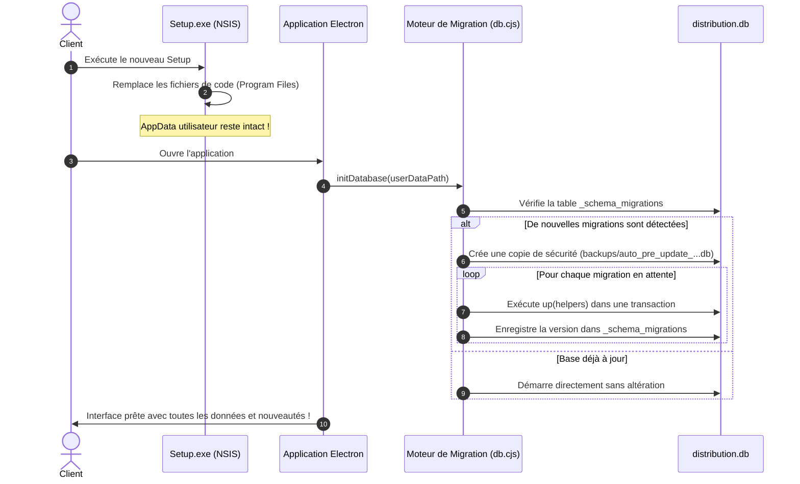

# 📘 Guide Technique : Mises à Jour & Migrations Automatiques (In-Place)

Ce document explique à l'équipe de développement comment fonctionne le système de mise à jour de l'application **imatechx**, comment ajouter de nouvelles fonctionnalités ou modifications de base de données dans les futures versions, et comment les clients reçoivent les mises à jour via le fichier d'installation `Setup.exe` **sans jamais avoir à désinstaller ni réinstaller**.

---

## 1. 🎯 Objectifs de l'Architecture

1. **Zéro désinstallation requise** : Le client exécute simplement le nouveau fichier d'installation `Setup.exe`.
2. **Zéro perte de données** : La base de données SQLite (`distribution.db`), les licences d'activation, les photos et les réglages sont préservés à 100 %.
3. **Mise à jour automatique de la base de données** : Au premier démarrage suivant l'installation, le logiciel applique automatiquement toutes les nouvelles tables, colonnes et index sans bloquer l'utilisateur.
4. **Sauvegarde automatique préventive** : Avant toute migration de base de données, un snapshot de sauvegarde est créé automatiquement dans le dossier `backups/`.

---

## 2. 🏗️ Comment ça fonctionne sous le capot ?

### Séparation des Fichiers (Code vs Données)
- **Fichiers exécutables & binaires** : Installés dans `C:\Program Files\imatechx` (ou le dossier choisi lors de l'installation).
- **Fichiers de données utilisateur (AppData)** : Stockés dans `%APPDATA%\imatechx\` :
  - `distribution.db` : Base de données SQLite de production.
  - `backups/` : Sauvegardes manuelles et sauvegardes automatiques de pré-mise à jour.
  - `activation.key` / Réglages locaux.

Lorsqu'un client exécute un nouveau `Setup.exe` :
1. L'installateur NSIS remplace uniquement les fichiers exécutables du logiciel.
2. Grâce au paramètre `"deleteAppDataOnUninstall": false` configuré dans `package.json`, le répertoire `%APPDATA%\imatechx\` reste strictement intact.
3. Lorsque l'application s'ouvre, elle charge le fichier `distribution.db` existant et déclenche le moteur de migration.



---

## 3. 👨‍💻 Guide Développeur : Comment ajouter une modification DB ?

Toutes les migrations sont gérées dans le fichier `electron/db.cjs`.

### Étape 1 : Ouvrir le tableau `MIGRATIONS_REGISTRY`
Dans `electron/db.cjs`, repérez le tableau `MIGRATIONS_REGISTRY` :

```javascript
const MIGRATIONS_REGISTRY = [
  {
    version: 1,
    name: 'v3_2_3_baseline_complete_schema',
    description: 'Baseline migration',
    up: (helpers) => { /* ... */ }
  }
];
```

### Étape 2 : Ajouter votre nouveau bloc de migration
Ajoutez un nouvel objet avec la version suivante (ex: `version: 2`) :

```javascript
  {
    version: 2,
    name: 'v3_3_0_nom_de_votre_fonctionnalite',
    description: 'Description claire de ce qui est ajouté ou modifié',
    up: (helpers) => {
      // 1. Ajouter une colonne à une table existante :
      helpers.addColumn('products', 'code_douane', "TEXT DEFAULT ''");
      helpers.addColumn('clients', 'points_fidelite', 'INTEGER DEFAULT 0');

      // 2. Créer une nouvelle table :
      helpers.addTable('promotions', `CREATE TABLE IF NOT EXISTS promotions (
        id INTEGER PRIMARY KEY AUTOINCREMENT,
        nom TEXT NOT NULL,
        taux_reduction REAL DEFAULT 0,
        date_debut TEXT,
        date_fin TEXT,
        actif INTEGER DEFAULT 1
      )`);

      // 3. Ajouter un index :
      helpers.addIndex('idx_promotions_actif', `CREATE INDEX IF NOT EXISTS idx_promotions_actif ON promotions(actif)`);

      // 4. Mettre à jour des données existantes si nécessaire :
      helpers.exec(`UPDATE products SET code_douane = '0000' WHERE code_douane IS NULL`);
    }
  }
```

> [!IMPORTANT]
> **Règles d'or pour les migrations :**
> - **Numéro de version strictement croissant** : Chaque nouvelle migration doit avoir `version = dernière_version + 1`.
> - **Ne modifiez jamais une migration passée** (ex: ne changez pas le contenu de `version: 1`), ajoutez toujours une nouvelle version pour vos changements.
> - **Idempotence** : Utilisez toujours les méthodes de `helpers` (`addColumn`, `addTable`, `addIndex`, `replaceTrigger`) car elles vérifient automatiquement l'existence avant d'exécuter.

---

## 4. 🧰 Les Helpers disponibles dans `up(helpers)`

| Méthode | Rôle | Exemple |
| :--- | :--- | :--- |
| `helpers.addColumn(table, column, def)` | Ajoute une colonne si elle n'existe pas déjà (évite les erreurs SQLite `duplicate column`). | `helpers.addColumn('clients', 'cin', "TEXT DEFAULT ''")` |
| `helpers.addTable(table, createSql)` | Crée une table si elle n'existe pas. | `helpers.addTable('notes', 'CREATE TABLE IF NOT EXISTS notes (...)')` |
| `helpers.addIndex(indexName, createSql)` | Crée un index de performance en toute sécurité. | `helpers.addIndex('idx_c_cin', 'CREATE INDEX IF NOT EXISTS idx_c_cin ON clients(cin)')` |
| `helpers.dropTrigger(triggerName)` | Supprime un trigger s'il existe. | `helpers.dropTrigger('trg_ventes_ad')` |
| `helpers.replaceTrigger(name, sql)` | Remplace proprement un trigger existant. | `helpers.replaceTrigger('trg_stock', 'CREATE TRIGGER trg_stock ...')` |
| `helpers.exec(sql)` | Exécute n'importe quelle commande SQL (mises à jour de données, nettoyage, etc.). | `helpers.exec('UPDATE app_settings SET value = "1" WHERE key = "flag"')` |
| `helpers.hasTable(table)` | Renvoie `true` si la table existe. | `if (helpers.hasTable('commandes')) { ... }` |
| `helpers.hasColumn(table, col)` | Renvoie `true` si la colonne existe. | `if (!helpers.hasColumn('users', 'email')) { ... }` |

---

## 5. 📦 Procédure de Publication d'une Mise à Jour

Lorsque le code et la migration sont prêts pour livraison :

### Étape 1 : Incrémenter la version du logiciel
Ouvrez `package.json` et incrémentez le champ `"version"` :
```json
{
  "name": "imatechx",
  "version": "3.3.0"
}
```

### Étape 2 : Vérification du typage TypeScript
```powershell
npx tsc --noEmit
```
*(Doit se terminer avec 0 erreur).*

### Étape 3 : Compiler le frontend Vite
```powershell
npm run build
```

### Étape 4 : Protéger le code backend (Chiffrement Bytecode V8)
```powershell
npm run protect
```
*(Cette commande compile `main.src.cjs` et `db.cjs` en fichiers `.jsc` protégés).*

### Étape 5 : Générer le fichier Setup
```powershell
npm run dist
```
L'installateur final sera généré dans le dossier `release/` (ex: `release/imatechx Setup 3.3.0.exe`).

---

## 6. 🛡️ Sécurité & Restauration d'urgence

Chaque fois que des migrations sont appliquées sur un PC client, une copie de sécurité préalable est automatiquement enregistrée :
```
%APPDATA%\imatechx\backups\auto_pre_update_<timestamp>_v<version>.db
```

En cas d'anomalie imprévue sur un poste client :
1. Fermez l'application.
2. Allez dans `%APPDATA%\imatechx\`.
3. Renommez `distribution.db` en `distribution_corrupted.db`.
4. Copiez le fichier `backups/auto_pre_update_...db` le plus récent et renommez-le en `distribution.db`.
5. Relancez l'application.

---

## 7. 🔍 Suivi et Audit des Mises à Jour

L'application conserve un historique complet :
- **Table `_schema_migrations`** : Contient toutes les migrations exécutées avec leurs horodatages et durées d'exécution.
- **Table `audit_logs`** : Enregistre automatiquement l'événement lors de chaque mise à jour logicielle (ex : `Mise à jour logicielle: v3.2.3 → v3.3.0`).
- **Table `app_settings`** : Stocke `installed_software_version` et `db_schema_version`.

